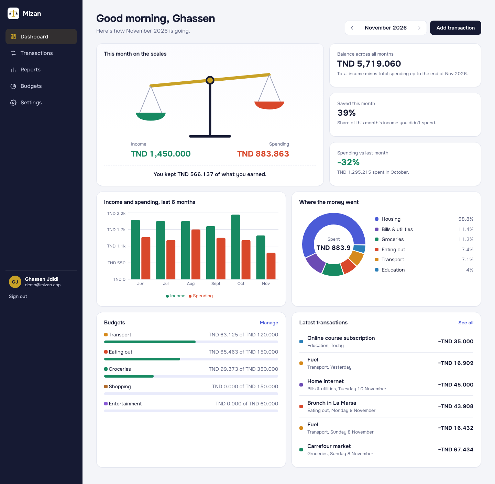

# Mizan: Expense Tracker Web Application

**Auspify Full Stack Development Internship, Task 3 (Medium)**
Ghassen Jdidi, November 2026

Mizan means "balance" in Arabic. It is a personal finance app where each person signs in, records income and expenses, sets monthly budgets and reads clear reports about where the money goes. React and Recharts on the front end, Node.js, Express and MongoDB on the back end, with secure cookie-based authentication.



**Demo account** (after `npm run seed`): `demo@mizan.app` / `Demo1234`, with 12 months of realistic data.

## Features

| Auspify key feature | What it does |
| --- | --- |
| Expense tracking | Add, edit and delete expenses with amount, category, date, description and payment method. The list is grouped by day, filterable by type, category, date range and text, and exportable to CSV. |
| Income management | The same flow for income, with its own categories (salary, freelance, scholarship and more). |
| Financial reports | Dashboard for any month, plus a Reports page for any period: money in and out, savings rate, average daily spending, month-by-month chart, spending and income by category, biggest expenses. |
| User authentication | Register, sign in and sign out, change password, delete account. Every record belongs to one user, and nobody can read or change another user's data. |

Also included:

- **The scales**: the dashboard draws the month as a balance scale that tips towards whichever side is heavier, income or spending.
- **Monthly budgets** per expense category, with progress bars that turn amber near the limit and red when it's passed.
- Six currencies (TND, USD, EUR, GBP, INR, MAD), chosen at sign-up and changeable in settings.
- Sign-in pages lead back to the page the person first asked for.

## Tech stack

- **Front end**: React 19, React Router 7, Recharts 3, Vite, plain CSS. Pages behind sign-in are code-split.
- **Back end**: Node.js 20+, Express 5, Mongoose 9, bcrypt password hashing, JSON Web Tokens
- **Database**: MongoDB, with aggregation pipelines (`$match` and `$group`) for every total and report
- **Tests**: Jest and Supertest (19 API tests)

## Security choices

- Passwords are hashed with bcrypt (cost 12) and never returned by the API.
- The session token is a signed JWT stored in an **httpOnly, SameSite=Lax cookie**, so page scripts can't read it and other sites can't send it with their forms. API clients like Postman can use the same token as a `Bearer` header.
- Sign-in and sign-up are rate-limited (20 attempts per 15 minutes per IP), and the same message is shown for a wrong email or a wrong password.
- Every query is scoped to the signed-in user; another user's transaction returns 404, not 403, so ids can't be probed.
- Helmet security headers, request size limits, whitelisted fields on every write, escaped search input, and CSV export that neutralises spreadsheet formulas.

## Project structure

```
Task3-Expense-Tracker/
├── server/
│   ├── src/
│   │   ├── app.js, server.js
│   │   ├── config/              db.js, categories.js
│   │   ├── models/              User, Transaction, Budget
│   │   ├── controllers/         auth, transactions (+ CSV export), reports, budgets
│   │   ├── middleware/          auth.js (JWT cookie or Bearer), errorHandler.js
│   │   ├── routes/index.js      every endpoint in one place
│   │   └── utils/               dates.js (month ranges), totals.js (aggregations)
│   ├── seed/seed.js             demo account with 12 months of data
│   └── tests/api.test.js
├── client/src/
│   ├── lib/                     api.js, format.js (money, dates, category colours)
│   ├── hooks/                   useAuth, useMeta
│   ├── components/              AppLayout, BalanceBeam, TransactionForm, Modal, Toast
│   └── pages/                   Login, Register, Dashboard, Transactions, Reports, Budgets, Settings
└── screenshots/
```

## Run it locally

You need **Node.js 20 or newer** and **MongoDB** (local or a free Atlas cluster).

```bash
cd Task3-Expense-Tracker
npm run install-all
cp server/.env.example server/.env
```

Open `server/.env` and set `JWT_SECRET` to a long random string. This command prints one:

```bash
node -e "console.log(require('crypto').randomBytes(48).toString('hex'))"
```

Then:

```bash
npm run seed       # creates demo@mizan.app / Demo1234
npm run dev        # API on :5000, React on :5173
```

Production mode on one port: `npm run build && npm start`, then open http://localhost:5000.

## REST API

Base URL: `/api`. Routes marked 🔒 need a signed-in user.

| Method | Endpoint | Description |
| --- | --- | --- |
| POST | `/auth/register` | Create an account and sign in |
| POST | `/auth/login` | Sign in |
| POST | `/auth/logout` | Sign out |
| GET | `/auth/session` | Current user, or `null` for visitors |
| GET 🔒 | `/auth/me` | Current user |
| PATCH 🔒 | `/auth/me` | Update name and currency |
| PATCH 🔒 | `/auth/password` | Change password |
| DELETE 🔒 | `/auth/me` | Delete the account and all its data |
| GET 🔒 | `/transactions` | List. Query: `type`, `category`, `from`, `to`, `search`, `sort`, `page`, `limit`. Returns totals for the whole filtered set. |
| POST 🔒 | `/transactions` | Create |
| GET / PUT / DELETE 🔒 | `/transactions/:id` | Read, update, delete one |
| GET 🔒 | `/transactions/export` | CSV download, same filters as the list |
| GET 🔒 | `/reports/summary?month=2026-11` | Everything the dashboard shows for one month |
| GET 🔒 | `/reports/trend?months=6&end=2026-11` | Income and spending per month |
| GET 🔒 | `/reports/range?from=2026-01-01&to=2026-11-30` | Full report for any period |
| GET 🔒 | `/budgets?month=2026-11` | Every expense category with its limit and spending |
| PUT / DELETE 🔒 | `/budgets/:category` | Set or remove a monthly limit |
| GET | `/meta` | Categories, payment methods and currencies |

## Tests

```bash
npm test
```

The 19 tests cover registration, bcrypt hashing, weak password and email rules, duplicate accounts, sign-in with right and wrong passwords, cookie and Bearer authentication, sign-out, profile and password changes, full transaction CRUD, category-type matching, data isolation between two users, filters, sorting, pagination, totals, CSV escaping, the month summary (with hand-checked numbers), trends, date-range reports, budgets and account deletion.

A full browser run was also tested end to end: redirect to sign-in, wrong password, dashboard, adding an expense with validation, filtering, searching, editing, deleting, CSV download, reports, budgets, currency change, sign-out, sign-up with a duplicate email, empty state for a new user and account deletion.

## Deploy (free)

1. Create a free MongoDB Atlas cluster and copy its connection string.
2. On Render, create a Web Service from the repository:
   - Build command: `npm run install-all && npm run build`
   - Start command: `npm start`
   - Environment: `MONGO_URI`, `JWT_SECRET` (long random string), `NODE_ENV=production`
3. Because the React app and the API share one domain, the auth cookie works without any extra CORS setup.

## How the Auspify workflow was followed

1. **Design dashboard screens**: dashboard, transactions, reports, budgets and settings, plus sign-in and sign-up.
2. **Create expense management APIs**: REST endpoints for transactions, budgets and reports.
3. **Store financial records in a database**: Mongoose models with validation and compound indexes on `user` and `date`.
4. **Display reports and summaries**: MongoDB aggregations feed Recharts bar, area and donut charts and category tables.
5. **Implement authentication**: bcrypt, JWT in an httpOnly cookie, protected routes on both server and client.

## Screenshots

| File | Shows |
| --- | --- |
| `01-sign-in.png` | Sign-in page |
| `02-dashboard.png` | Monthly dashboard with the scales, charts, budgets and latest transactions |
| `03-add-transaction.png` | Adding an expense |
| `04-transactions-filtered.png` | Transactions filtered to groceries, with totals |
| `05-transactions.png` | Transactions grouped by day |
| `06-reports.png` | Report for this year |
| `07-budgets.png` | Monthly budgets |
| `08-settings.png` | Profile, password and account settings |
| `09-mobile-dashboard.png`, `10-mobile-transactions.png` | Phone layout |
